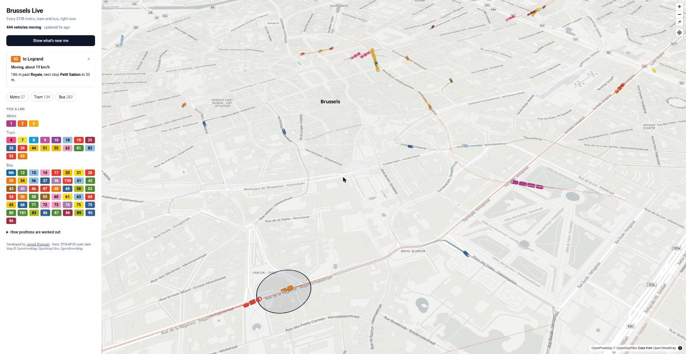

# Brussels Live

Every STIB metro, tram and bus in Brussels on one map, moving in real time, in STIB's own line colours. Plus what's arriving at the stops near you.

**Try it:** https://live.jwds.me (works on a phone; "Near me" needs location permission). Also at https://huntsama.github.io/brussels-live/.


| Zoomed in: vehicles at real length, tilted map | Near me: what leaves from the closest stops |
|---|---|
|  |  |

## Stack

- **Data:** STIB-MIVB open data (live vehicle positions and arrival predictions, stop lists, GTFS timetable), all free and keyless. No backend: the browser reads the feeds directly.
- **Build:** Python 3 (standard library) joins stops, routes and timetable into `network.json`; runs weekly in GitHub Actions.
- **Page:** MapLibre GL JS + OpenFreeMap tiles, deck.gl (WebGL) for vehicles and trails, Tailwind CSS, Geolocation API, web app manifest.
- **Estimation:** `site/estimator.js`, plain JavaScript, with an offline evaluation loop in Node (`tools/`).
- **Quality:** pytest, `node --test`, GitHub Actions, GitHub Pages.
- Sister project: [Brussels Lakehouse](https://github.com/Huntsama/brussels-lakehouse), which records the same feeds every 5 minutes on Azure and feeds this map its "usually late" numbers.

## The problem: STIB has no GPS feed

STIB's open data doesn't say where a vehicle *is*. Every ~20 seconds it says, per line:

```json
{"directionId": "8161", "pointId": "8012", "distanceFromPoint": 120}
```

"Heading to stop 8161, 120 metres past stop 8012". No coordinates, and no vehicle IDs.

## How it's turned into a moving dot

1. **Network (weekly, `build_network.py`)**
   - Joins three STIB sources:
     - the stops of each line in order (`StopsByLine`);
     - where each stop is (`StopDetails`);
     - the road each line drives on (`shapes.txt` from the GTFS timetable).
   - For each line and direction, it picks the timetable shape that best follows the stops.
   - It then measures how far along that road each stop is.
   - Output: `network.json` (about 250 KB gzipped). It covers 140 routes on 70 lines and 2,150 stops.
2. **Position:** a vehicle sits at `distance of last stop + metres since`, capped at the next stop, then placed on the road at that distance.
3. **Identity:** with no vehicle IDs, each new reading is matched to the previous reading just behind it on the same route.
4. **Movement:** STIB's feed changes about every 15–20 s. The page checks every 10 s, and only while it's on screen.
   - Each frame, a vehicle moves towards where it should be now: its last reading plus its own measured speed since (× 0.9, so it would rather lag than run ahead).
   - Gaps close over about 2 s, never faster than a real vehicle (metro 80, tram 55, bus 50 km/h).
   - Only gaps over 600 m (back from another app, a new vehicle) jump instead.
   - **Stop sync:** when STIB reports a vehicle at a new stop, the dot hurries there in about 1.5 s, so the map re-syncs at every station.
   - **New vehicles** move at 1.2× the timetable's average speed for that segment until they have two readings of their own. One standing at a stop waits.
   - **Status:** the vehicle panel says what it's doing, in plain words: "Moving, about 24 km/h", "Stopped at Trône" or "Waiting between stops".
   - It stops at the next stop until STIB confirms it has passed, and it never moves backwards.
5. **Direction:** `directionId` is the terminus. A short-turning vehicle is matched to the route that contains both its stop and its terminus.

The page reads STIB's feed straight from the browser (it allows cross-origin requests, no key), so there is no backend.

## Near me

- **Your location:** "Show what's near me" uses the browser's Geolocation API through MapLibre's locate control (blue dot, accuracy circle, follow mode). It **stays on the device**: no server, nothing stored.
- **Nearby stops:** the 2 closest stops within 300 m (or the nearest one within 1 km), grouped by name, with walking time.
- **"Leaving from near you":** one row per line and direction (`71 → Delta  6 min · 15`), from STIB's own `WaitingTimes` predictions, refreshed every 20 s.
- **A calm map:** the rest of the city is hidden. You see only:
  - the road each of those lines takes onward from your stop, labelled with where it ends;
  - the vehicles still coming towards you.
- **Tap a row** to keep only that line. "Show all of Brussels" brings the full map back.
- **Install as an app:** a web app manifest lets you add it to your phone's home screen, where it opens full screen like an app.

## Drawing

- **MapLibre GL JS** draws the base map (OpenFreeMap vector tiles, no key needed).
- **deck.gl** draws on the GPU:
  - each vehicle as a top-down metro (4 cars), tram (3 sections) or bus in its line colour, turned to face along the road;
  - a fading trail behind each vehicle (`TripsLayer`);
  - the whole network as faint lines.
- **Sizes:** zoomed in, vehicles are drawn at roughly real length (metro 92 m, tram 44 m, bus 18 m). Zoomed out, they keep a minimum size so they stay visible.
- **Tilt:** right-drag (or two fingers) tilts the map.

## How good is the estimate? Measured, not guessed

`tools/` holds a small evaluation loop, so every change to the estimator is scored on real data instead of eyeballed:

1. `record.js` saves STIB's feed for a few minutes (one line per change).
2. `replay.js` runs the estimator (`site/estimator.js`, the same code the page uses) over the recording and, at every real reading, measures how far the dot was from where the vehicle actually was.
3. `fit.js` turns a recording into rows of *state → what happened next*, to fit the speed model.

What the data showed, and what changed because of it:

- **A line's positions refresh every ~31 s, while the feed as a whole changes every ~15 s.** In 44% of feeds a line's data is a repeat. The first version read a repeat as "the vehicle stopped", which froze dots and made them lag. The estimator now detects, per line, whether STIB refreshed the data and keeps predicting when it didn't.
- **The timetable knows each segment's speed.** GTFS `stop_times` gives a scheduled time between every pair of consecutive stops (2,958 of the 3,035 segments matched), so a vehicle starts at that segment's speed instead of a fixed guess per mode.
- **Constants were tuned by grid search** on one recording (`PARAMS='{"AHEAD":1}' node tools/replay.js …`) and checked on a second, unseen one.

Result on the unseen recording (6 minutes, 5,462 real readings):

| | Old | Now |
|---|---|---|
| Typical error (median) | 48 m | 46 m |
| Bias (negative = dot behind the vehicle) | −24 m | +0 m |
| Readings where the dot was >50 m behind | 30% | 23% |

The remaining ~45 m is mostly what can't be known from this feed: a vehicle's reading is up to 30 s old, and nothing says how long it will wait at a stop or a light. The next signal to add is STIB's own arrival predictions (`WaitingTimes`), which say when a vehicle will reach its next stop.

## Fed by Brussels Lakehouse

[Brussels Lakehouse](https://github.com/Huntsama/brussels-lakehouse) has recorded STIB every 5 minutes since October. It publishes `lines.json`, which gives each line's typical lateness by hour of day. Click a vehicle and the panel shows, for example, *"At this hour line 71 is usually 0.6 min late"*. The lakehouse answers how late lines usually are; this map shows where the vehicles are now.

## Run locally

```bash
python3 build_network.py site/network.json   # stdlib only, ~10 s
cd site && python3 -m http.server
```

## Limits

- Positions are estimates. They're exact at stops and linear in between.
- About 12 routes currently run on roadworks diversions that the timetable shape doesn't match. Those are drawn as straight lines between stops.
- `M6`, `T39` and `T81` are replacement buses for metro 6 and trams 39 and 81, so they're shown as buses.

## Licence

MIT. Developed by [Jawad Shaissah](https://www.jwds.me). Data: STIB-MIVB open data. Map: OpenFreeMap, OpenMapTiles, © OpenStreetMap contributors.
