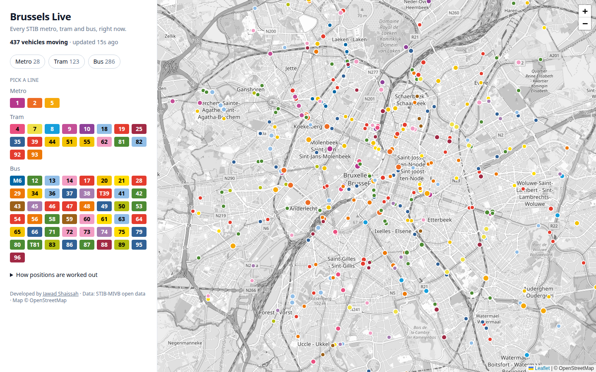
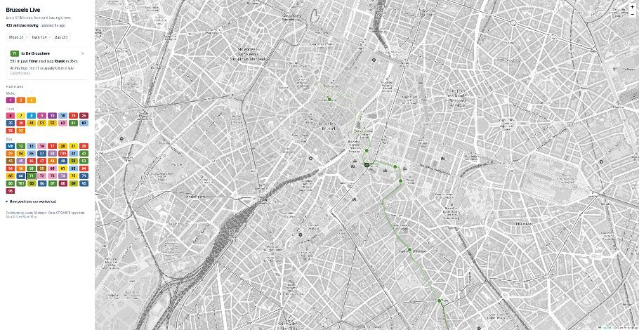

# Brussels Live

Every STIB metro, tram and bus in Brussels on one map, moving in real time, in STIB's own line colours.

**Live:** https://huntsama.github.io/brussels-live/



## The problem: STIB has no GPS feed

STIB's open data doesn't say where a vehicle *is*. Every ~20 seconds it says, per line:

```json
{"directionId": "8161", "pointId": "8012", "distanceFromPoint": 120}
```

"Heading to stop 8161, 120 metres past stop 8012". No coordinates, and no vehicle IDs.

## How it's turned into a moving dot

1. **Network (weekly, `build_network.py`)**
   - Joins three STIB sources:
     - the stops of each line in order (`StopsByLine`);
     - where each stop is (`StopDetails`);
     - the road each line drives on (`shapes.txt` from the GTFS timetable).
   - For each line and direction, it picks the timetable shape that best follows the stops.
   - It then measures how far along that road each stop is.
   - Output: `network.json` (about 250 KB gzipped). It covers 140 routes on 70 lines and 2,150 stops.
2. **Position:** a vehicle sits at `distance of last stop + metres since`, capped at the next stop, then placed on the road at that distance.
3. **Identity:** with no vehicle IDs, each new reading is matched to the previous reading just behind it on the same route. It then glides from the old position to the new one over the next 20 seconds. So a dot is about 20 s behind reality but never jumps.
4. **Direction:** `directionId` is the terminus. A short-turning vehicle is matched to the route that contains both its stop and its terminus.

The page reads STIB's feed straight from the browser (it allows cross-origin requests, no key), so there is no backend.



## Run locally

```bash
python3 build_network.py site/network.json   # stdlib only, ~10 s
cd site && python3 -m http.server
```

## Limits

- Positions are estimates. They're exact at stops and linear in between.
- About 12 routes currently run on roadworks diversions that the timetable shape doesn't match. Those are drawn as straight lines between stops.
- `M6`, `T39` and `T81` are replacement buses for metro 6 and trams 39 and 81, so they're shown as buses.

Developed by [Jawad Shaissah](https://www.jwds.me). Data: STIB-MIVB open data. Map © OpenStreetMap contributors.
